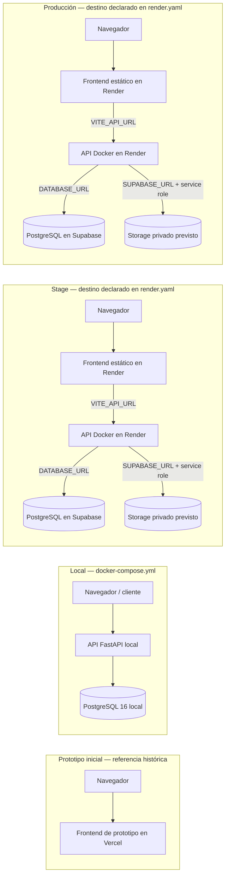

# Arquitectura física y ambientes

**Revisión del repositorio:** 2 de noviembre de 2026. **Alcance:** configuración versionada; no se han consultado paneles de Render, Supabase, Vercel ni GitHub para confirmar servicios activos o despliegues. Los nombres de servicio y destinos indicados son los declarados o previstos en los archivos del repositorio, no prueba de que estén publicados.

## Vista por ambiente

El bloque Vercel es la separación indicada para el prototipo inicial. La configuración actual de `render.yaml` describe cuatro servicios Render para stage y producción. El pipeline de `.github/workflows/ci-cd.yml` pide despliegues por hooks al hacer push a `main`, y condiciona producción a la aprobación del environment `production`. El flujo versionado no espera ni consulta la finalización del build en Render; el éxito del `curl` solo acredita que se aceptó el pedido.

## Ambientes y límites de confianza

| Ambiente | Componentes definidos | Datos y credenciales | Estado comprobable desde el repositorio |
|---|---|---|---|
| Prototipo | Frontend inicial en Vercel, fuera del despliegue actual de la app | No reutilizar credenciales o datos reales de producción | Referencia de arquitectura; no hay configuración Vercel en este checkout. |
| Local | API y frontend se ejecutan por separado; `docker-compose.yml` inicia PostgreSQL 16 | Datos sintéticos; `.env.example` sirve como plantilla. No usar secretos reales en Git | PostgreSQL local sí está configurado. La API usa `DATABASE_URL`; el compose no declara un servicio API. |
| Stage | `ayni-web-stage` estático y `ayni-api-stage` Docker en Render; base Supabase separada | Variables `DATABASE_URL`, `JWT_SECRET`, `SUPABASE_URL`, `SUPABASE_SERVICE_ROLE_KEY`; secretos deben vivir en el proveedor | Blueprint presente; `sync: false` significa que los valores se deben proporcionar. Actividad/URL/despliegue no comprobados. |
| Producción | `ayni-web-prod` estático y `ayni-api-prod` Docker en Render; proyecto Supabase separado | Credenciales distintas a stage; JWT propio, bucket privado previsto | Blueprint presente; actividad/URL/despliegue no comprobados. |

El navegador solo debe conocer la URL pública del frontend y `VITE_API_URL`; nunca recibe `SUPABASE_SERVICE_ROLE_KEY` ni `JWT_SECRET`. La API es el límite de confianza para autorización familiar y acceso a la base. La service role de Supabase es una credencial privilegiada de servidor. `render.yaml` declara `SUPABASE_URL` y `SUPABASE_SERVICE_ROLE_KEY`, pero el código de esta revisión no implementa subida de fotos ni almacenamiento Supabase: no se debe inferir que ya existe un bucket privado operativo.

## Despliegue y salud

- `render.yaml`: API Docker con `healthCheckPath: /health`, web estática, regiones `virginia`, `plan: free` y `autoDeployTrigger: "off"`.
- `.github/workflows/ci-cd.yml`: build/tests y seguridad en PR; en push a `main` hace POST a los hooks configurados en los environments `stage` y `production`. El entorno producción requiere la aprobación configurada en GitHub.
- El workflow usa estos nombres de secretos: `RENDER_API_STAGE_HOOK`, `RENDER_WEB_STAGE_HOOK`, `RENDER_API_PROD_HOOK`, `RENDER_WEB_PROD_HOOK` (cada uno en su environment). Nombres antiguos o distintos no conectarán este pipeline.
- `/health` devuelve estado de la API y ambiente. `/health/db` hace `SELECT 1` y devuelve `503` cuando no se puede consultar la base. El chequeo de Render actualmente apunta a `/health`, no a `/health/db`.
- Un POST exitoso al deploy hook no confirma que el build termine ni que la aplicación sirva tráfico. Registrar por separado commit solicitado, estado del evento en Render, URL y commit publicado, health checks, migración y smoke checks.

## Contraste de fuentes y discrepancias

| Tema | Configuración observada | Implicación |
|---|---|---|
| Rutas de API | `main.py` monta familias y recuerdos; no agrega prefijo global | La API está en raíz del host. |
| Contratos | Hay consentimiento, autenticación, familia, perfil, invitaciones y CRUD de recuerdos | No anunciar sesiones, responses, insights HTTP, fotos, billing ni borrado de cuenta como endpoints disponibles. |
| DB local | Compose solo inicia Postgres; variables y migraciones se describen en README/guías | Iniciar el contenedor no ejecuta API, migraciones ni pruebas. |
| Supabase Storage | Variables están declaradas en Blueprint | No se encontró código de fotos/storage en los módulos actuales. |
| Hooks | El workflow usa `RENDER_*_HOOK`; la guía de Gonzalo anterior nombra `RENDER_DEPLOY_HOOK_*` | La guía quedó desalineada con el pipeline y se debe usar el nombre que consume el workflow. |
| Despliegue | `curl` pasa `ref=$GITHUB_SHA` a cada hook | Un `2xx` registra aceptación de solicitud; el build/publicación debe confirmarse en Render. |

## Evidencia requerida para afirmar un despliegue real

Para cada ambiente, registrar en la tarea/PR fecha real, commit solicitado y desplegado, URL del frontend/API, evento final de Render, resultado de `/health` y `/health/db`, conexión con la base, origen CORS del frontend y estado de migraciones. Para fotos, antes de declarar aceptación, verificar bucket privado, firma y expiración de URL y acceso cruzado entre dos familias sintéticas. No adjuntar URLs con tokens, hooks, claves, cadenas de conexión ni datos personales.

### Archivos de referencia

- [`render.yaml`](../render.yaml)
- [Workflow CI/CD](../.github/workflows/ci-cd.yml)
- [`docker-compose.yml`](../docker-compose.yml)
- [API y contratos implementados](API_ENDPOINTS.md)
- [Modelo de datos](MODELO_DATOS.md)
- [Guía de DevOps y QA](guias/gonzalo-devops-qa.md)
