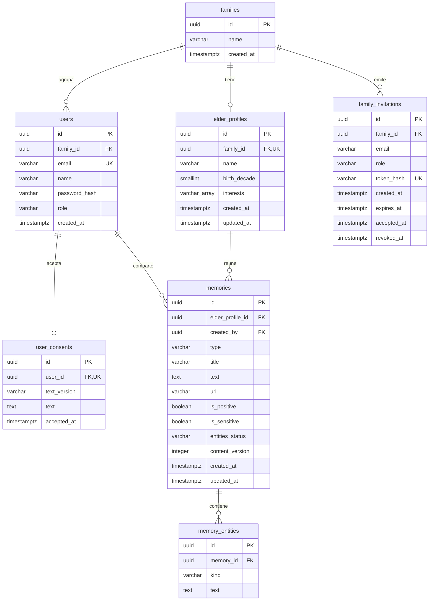

# Modelo de datos de Ayni — AYNI-59

**Responsable:** Marcelo Martinez (Hats).

**Fecha de revisión del código:** 1 de noviembre de 2026.

**Base revisada:** `main`, commit `8438712`.

**Estado:** formalización del diseño de datos y su correspondencia con la implementación; documento para revisión.

## 1. Diseño conceptual, alcance y fuentes

El modelo de datos define qué información necesita Ayni, cómo se relaciona y qué reglas debe cumplir. Su diseño debe orientar la creación de las tablas. Por eso este documento presenta primero las entidades del dominio y después su representación en modelos SQLAlchemy, restricciones SQL y migraciones para PostgreSQL en Supabase.

### 1.1. Entidades y relaciones del dominio

| Entidad conceptual | Propósito y relación |
|---|---|
| Familia | Agrupa las cuentas y el perfil del adulto mayor en un espacio privado |
| Usuario | Pertenece a una familia y participa como cuidador principal o familiar |
| Perfil del adulto mayor | Reúne nombre, década de nacimiento e intereses; cada familia puede tener un perfil |
| Consentimiento | Vincula al usuario con el texto aceptado, su versión y la fecha de aceptación |
| Invitación | Permite incorporar un familiar mediante una invitación asociada a la familia y al correo destinatario |
| Recuerdo | Pertenece al perfil y tiene un autor; actualmente puede ser una anécdota o una canción, con marcas positivo y sensible |
| Entidad extraída | Identifica una persona, lugar, época o actividad mencionada en una anécdota |

Las sesiones, sus elementos, las reacciones y las fotos se separan en la sección 7 como diseño pendiente de concretar e implementar.

### 1.2. Del diseño a las tablas

El orden de trabajo previsto para un cambio de esquema es:

1. Definir entidades, relaciones, campos y reglas de integridad en el modelo de datos.
2. Representar el diseño mediante modelos SQLAlchemy.
3. Generar una migración con Alembic y revisar el SQL y las restricciones resultantes.
4. Aplicar la migración con `alembic upgrade head` sobre PostgreSQL, localmente o en Supabase según el entorno.
5. Verificar el resultado con pruebas y mantener la documentación alineada con los cambios.

**Trazabilidad de esta versión:** el documento se formaliza el 1 de noviembre de 2026 sobre un diseño ya representado en el código y en migraciones existentes. El orden anterior explica el proceso de diseño e implementación; no afirma que este archivo se haya redactado antes de esas migraciones. Las fechas históricas se conservan en Git.

### 1.3. Fuentes y alcance de la comprobación

Las secciones 2 a 6 detallan las siete tablas que ya tienen modelos SQLAlchemy y migraciones de Alembic en el repositorio. La existencia de una tabla no demuestra por sí sola que un flujo completo esté validado en stage.

| Fuente | Qué permite comprobar |
|---|---|
| [Reglas del proyecto](../CLAUDE.md) | Dominio, arquitectura, privacidad y modelo conceptual previsto |
| [Guía de backend](guias/hats-backend.md) | Responsabilidades, migraciones y reglas de los módulos |
| [Modelos de families](../backend/app/modules/families/models.py) | Cinco tablas de cuentas, familias, perfil, consentimiento e invitaciones |
| [Migración de families](../backend/migrations/versions/dc9bbbc9f360_create_families_tables.py) | Restricciones y tablas creadas en PostgreSQL |
| [Modelos de memories](../backend/app/modules/memories/models.py) | Recuerdos y entidades extraídas |
| [Migración de memories](../backend/migrations/versions/91f7f254a4e4_create_memories_tables.py) | Restricciones y tablas de recuerdos |
| [Servicio de families](../backend/app/modules/families/service.py) y [schemas](../backend/app/modules/families/schemas.py) | Roles, registro, consentimiento y validación de entradas |
| [Servicio de memories](../backend/app/modules/memories/service.py), [repositorio](../backend/app/modules/memories/repository.py) y [schemas](../backend/app/modules/memories/schemas.py) | Aislamiento, permisos, contenido y consultas |
| [Extracción de entidades](../backend/app/modules/memories/extraction.py) | Sesiones independientes y control de versiones del texto |

## 2. Diagrama entidad-relación implementado

En el diagrama, `||` significa exactamente uno, `o|` cero o uno y `o{` cero o muchos. Se representa lo que permite la base de datos: una familia puede existir sin perfil y la FK por sí sola no obliga a crear usuarios o consentimientos. El servicio de registro sí crea usuario y consentimiento juntos.



## 3. Diccionario de datos implementado

`PK`: clave primaria; `FK`: clave foránea; `UQ`: unicidad. Todos los campos son `NOT NULL`, salvo los indicados con **Sí** en la columna «¿NULL?». `timestamptz` corresponde a `DateTime(timezone=True)` en SQLAlchemy; la API normaliza las fechas de salida a UTC.

Todos los `id` son UUID generados con `uuid4` por Python al insertar mediante SQLAlchemy: las migraciones no declaran un generador UUID por defecto en PostgreSQL. Los valores `now()`, `false`, `1` y el arreglo vacío que se señalan como predeterminados SQL sí están declarados en las migraciones. Los enums actuales se guardan como `VARCHAR` con `CHECK`, no como tipos enum nativos de PostgreSQL.

### 3.1. `families` — espacio familiar

| Campo | Tipo | ¿NULL? | Regla o significado |
|---|---|---|---|
| `id` | UUID | No | PK |
| `name` | VARCHAR(100) | No | Nombre del espacio familiar; `CHECK` impide texto en blanco |
| `created_at` | TIMESTAMPTZ | No | Predeterminado SQL `now()` |

### 3.2. `users` — cuentas y pertenencia familiar

| Campo | Tipo | ¿NULL? | Regla o significado |
|---|---|---|---|
| `id` | UUID | No | PK |
| `family_id` | UUID | No | FK → `families.id`, `ON DELETE CASCADE` |
| `email` | VARCHAR(254) | No | UQ global; `CHECK` exige minúsculas, sin espacios en extremos y no vacío |
| `name` | VARCHAR(100) | No | Nombre de la cuenta; `CHECK` impide texto en blanco |
| `password_hash` | VARCHAR(255) | No | Hash Argon2; nunca la contraseña original |
| `role` | VARCHAR con CHECK | No | `cuidador_principal` o `familiar` |
| `created_at` | TIMESTAMPTZ | No | Predeterminado SQL `now()` |

Índices y unicidad: `uq_users_email`, `ix_users_family_id` y el índice único parcial `uq_users_family_primary_caregiver` sobre `family_id` cuando `role = 'cuidador_principal'`. Este último garantiza **como máximo un cuidador principal por familia**; el registro inicial es quien crea ese cuidador. El esquema no representa que una cuenta pertenezca a varias familias.

### 3.3. `elder_profiles` — perfil del adulto mayor

| Campo | Tipo | ¿NULL? | Regla o significado |
|---|---|---|---|
| `id` | UUID | No | PK |
| `family_id` | UUID | No | FK → `families.id`, `ON DELETE CASCADE`; UQ `uq_elder_profiles_family_id` |
| `name` | VARCHAR(100) | No | Nombre; `CHECK` impide texto en blanco |
| `birth_decade` | SMALLINT | No | Década de nacimiento; no negativa, múltiplo de 10 y no mayor al año actual |
| `interests` | VARCHAR(100)[] | No | Predeterminado SQL `{}` y lista vacía en Python; máximo 20 elementos, sin elementos NULL |
| `created_at` | TIMESTAMPTZ | No | Predeterminado SQL `now()` |
| `updated_at` | TIMESTAMPTZ | No | Predeterminado SQL `now()`; actualización mediante `onupdate` de SQLAlchemy |

La API exige nombre e intereses de 1–100 caracteres después de quitar espacios exteriores. La base admite una lista vacía de intereses. `updated_at` no tiene un trigger de PostgreSQL: una actualización SQL directa debe gestionarlo explícitamente.

### 3.4. `user_consents` — evidencia de aceptación

| Campo | Tipo | ¿NULL? | Regla o significado |
|---|---|---|---|
| `id` | UUID | No | PK |
| `user_id` | UUID | No | FK → `users.id`, `ON DELETE CASCADE`; UQ `uq_user_consents_user_id` |
| `text_version` | VARCHAR(20) | No | Versión aceptada; `CHECK` impide texto en blanco |
| `text` | TEXT | No | Copia del texto aceptado; `CHECK` impide texto en blanco |
| `accepted_at` | TIMESTAMPTZ | No | Fecha de aceptación; predeterminado SQL `now()` |

El registro exige `consent.accepted = true` y `text_version = "1.0"`. No existe una columna `accepted`: la fila registra la aceptación, con fecha, versión y copia del texto. La unicidad actual permite un consentimiento por usuario; no implementa un historial de varias versiones por cuenta.

La fuente reutilizada por `GET /auth/consent` y el registro es [consent.py](../backend/app/modules/families/consent.py). Texto de consentimiento versión **1.0**:

> Acepto que Ayni guarde y use los datos que comparto para organizar actividades familiares. Entiendo que estos datos se almacenan fuera del Perú, en Estados Unidos, mediante Supabase y Render.

El `onboarding_notice` se obtiene de ese mismo archivo y de `GET /auth/consent`; es un aviso informativo y no una columna adicional del consentimiento.

### 3.5. `family_invitations` — invitaciones de acceso

| Campo | Tipo | ¿NULL? | Regla o significado |
|---|---|---|---|
| `id` | UUID | No | PK |
| `family_id` | UUID | No | FK → `families.id`, `ON DELETE CASCADE`; índice `ix_family_invitations_family_id` |
| `email` | VARCHAR(254) | No | Destinatario; `CHECK` de normalización y contenido no vacío |
| `role` | VARCHAR(20) | No | `CHECK`: solo `familiar`; predeterminado en Python, sin predeterminado SQL |
| `token_hash` | VARCHAR(64) | No | UQ `uq_family_invitations_token_hash`; longitud 64; servicio calcula SHA-256 |
| `created_at` | TIMESTAMPTZ | No | Predeterminado SQL `now()`; el servicio fija el instante al crear |
| `expires_at` | TIMESTAMPTZ | No | Debe ser posterior a `created_at` |
| `accepted_at` | TIMESTAMPTZ | Sí | Si existe: `created_at <= accepted_at < expires_at` |
| `revoked_at` | TIMESTAMPTZ | Sí | Si existe: `revoked_at >= created_at` |

Un `CHECK` impide que `accepted_at` y `revoked_at` estén ambos definidos. El servicio calcula el estado pendiente, aceptada, revocada o vencida; no hay columna `status`. La duración predeterminada es **72 horas**, configurable mediante `INVITATION_EXPIRE_HOURS`; no es una restricción SQL de duración fija.

El token original se devuelve al crear la invitación y no se guarda en la tabla. El registro compara su hash, comprueba el correo normalizado, vigencia y ausencia de aceptación o revocación. Una invitación aceptada no se reutiliza. La lista del cuidador incluye todos los estados. Evitar invitaciones pendientes duplicadas es una regla del servicio, no un índice único sobre el correo.

### 3.6. `memories` — anécdotas y canciones

| Campo | Tipo | ¿NULL? | Regla o significado |
|---|---|---|---|
| `id` | UUID | No | PK |
| `elder_profile_id` | UUID | No | FK → `elder_profiles.id`, `ON DELETE CASCADE` |
| `created_by` | UUID | No | FK → `users.id`, `ON DELETE CASCADE`; identifica al autor |
| `type` | VARCHAR con CHECK | No | Solo `anecdote` o `song` |
| `title` | VARCHAR(100) | No | No blanco; API valida longitud 1–100 |
| `text` | TEXT | Sí | Obligatorio solo para anécdotas: no blanco y máximo 5000 caracteres |
| `url` | VARCHAR(2048) | Sí | Obligatorio solo para canciones; SQL exige prefijo `https://` |
| `is_positive` | BOOLEAN | No | Predeterminado SQL y Python `false` |
| `is_sensitive` | BOOLEAN | No | Predeterminado SQL y Python `false` |
| `entities_status` | VARCHAR con CHECK | No | `pending`, `completed`, `failed` o `not_applicable`; predeterminado SQL `pending` |
| `content_version` | INTEGER | No | Predeterminado SQL y Python `1`; `CHECK >= 1` |
| `created_at` | TIMESTAMPTZ | No | Predeterminado SQL `now()` |
| `updated_at` | TIMESTAMPTZ | No | Predeterminado SQL `now()`; `onupdate` de SQLAlchemy, sin trigger SQL |

El `CHECK ck_memories_content_for_type` exige que una anécdota tenga `text`, no tenga `url` y no use estado `not_applicable`; una canción tiene `url`, no tiene `text` y usa `not_applicable`. El repositorio asigna el estado correcto para cada tipo.

La API valida y normaliza enlaces de videos de YouTube o pistas de Spotify; no admite enlaces que solo identifiquen playlists. La restricción de proveedores es de los schemas, no del `CHECK` SQL. No se almacena audio. Las fotos aún no forman parte del enum ni de esta migración.

Índices: `ix_memories_created_by` y `ix_memories_profile_created_id` (`elder_profile_id`, `created_at`, `id`). El listado ordena por fecha e ID descendentes y admite paginación.

### 3.7. `memory_entities` — entidades extraídas de anécdotas

| Campo | Tipo | ¿NULL? | Regla o significado |
|---|---|---|---|
| `id` | UUID | No | PK |
| `memory_id` | UUID | No | FK → `memories.id`, `ON DELETE CASCADE`; índice `ix_memory_entities_memory_id` |
| `kind` | VARCHAR con CHECK | No | `person`, `place`, `period` o `activity` |
| `text` | TEXT | No | `CHECK`: no blanco y máximo 5000 caracteres |

No existe una restricción SQL de unicidad por entidad. Al reemplazarlas, el repositorio elimina duplicados por tipo y texto sin distinguir mayúsculas. El módulo NLP no agrega tablas propias a este esquema.

## 4. Integridad, permisos y aislamiento

| Regla | Garantía actual |
|---|---|
| Pertenencia familiar | Cada usuario tiene una FK obligatoria a una familia. El servicio obtiene la familia del usuario autenticado, no de un `family_id` elegido en la petición |
| Registro de cuidador | El servicio crea usuario, familia y consentimiento en una transacción |
| Credenciales | Correo normalizado a minúsculas; contraseña mínima de 10 caracteres validada en la API; se persiste solo su hash Argon2 |
| Perfil | Ambos roles pueden consultarlo; solo `cuidador_principal` puede crearlo o actualizarlo |
| Invitaciones | Solo `cuidador_principal` puede crearlas, listarlas y revocarlas |
| Lectura y creación de recuerdos | Ambos roles, dentro del perfil de su propia familia; se exige que ese perfil exista |
| Edición y eliminación de recuerdos | Solo el autor o el cuidador principal de esa familia |
| Recursos ajenos | Las consultas de recuerdos se filtran por el perfil autorizado; un ID de otra familia no permite consultar o modificar el recurso |
| Sensibles | El listado excluye `is_sensitive = true` por defecto; se incluyen únicamente si se solicita `include_sensitive=true` dentro de la misma familia |
| Marcas de contenido | `is_positive` e `is_sensitive` son independientes; ambos pueden ser verdaderos. La generación futura debe excluir los sensibles aunque sean positivos |

**Límite importante:** las FK de `memories.created_by` y `memories.elder_profile_id` validan que existan el autor y el perfil, pero no que pertenezcan a la misma familia. Esa coincidencia la garantiza el servicio. Este documento no atribuye al esquema políticas RLS de Supabase que no están declaradas en las migraciones revisadas.

Los JWT se envían como `Authorization: Bearer <access_token>`; no hay tabla de tokens de acceso en este modelo. Los módulos acceden a otro módulo mediante su `service.py`, no mediante sus modelos o repositorios.

## 5. Extracción y versionado

1. La anécdota se guarda antes de programar la extracción en segundo plano. La canción queda en `not_applicable`.
2. La tarea abre sus propias sesiones de base de datos y lee una copia del texto con `content_version`. No reutiliza la sesión de la petición ni mantiene una transacción abierta mientras llama al extractor.
3. La llamada pública a NLP recibe únicamente el texto; no recibe correo, IDs ni datos de la cuenta. El texto puede contener nombres compartidos por la familia, por lo que tampoco debe imprimirse en logs.
4. Un resultado válido, incluso vacío, termina en `completed`. Un fallo se intenta registrar como `failed`; si la base de datos está caída, también puede fallar esa escritura. No hay una cola duradera o reintento automático garantizado.
5. Al cambiar el texto se incrementa `content_version`, se borran las entidades previas y vuelve a `pending`. Un resultado de una versión antigua o de un recuerdo eliminado se descarta.

## 6. Eliminación: comportamiento existente y trabajo pendiente

Todas las FK descritas usan `ON DELETE CASCADE`. Esto es comportamiento de persistencia.

| Fila eliminada | Efecto en la base actual |
|---|---|
| `memory` | Elimina sus `memory_entities` |
| `user` | Elimina su consentimiento y los recuerdos de su autoría, con sus entidades |
| `elder_profile` | Elimina sus recuerdos y entidades; no elimina las cuentas de la familia |
| `family` | Elimina usuarios, perfil e invitaciones; también consentimientos, recuerdos y entidades por las cascadas anteriores |
| `family_invitation` | Elimina esa invitación; no elimina usuarios que ya se registraron |

## 7. Implementación física: migraciones y correspondencia con stage

Cadena existente:

```text
<base> -> 0001 (baseline vacío)
       -> dc9bbbc9f360 (families: cinco tablas)
       -> 91f7f254a4e4 (memories: dos tablas; cabeza esperada)
```

[env.py](../backend/migrations/env.py) importa los modelos de ambos módulos para el metadata de Alembic. El [Dockerfile](../backend/Dockerfile) ejecuta `alembic upgrade head` antes de iniciar la API. Los cambios de esquema deben agregarse mediante nuevas migraciones revisadas; este documento no necesita una nueva migración.

Comprobaciones reproducibles desde `backend/`, con las dependencias ya instaladas y una base local de pruebas configurada:

```bash
uv run alembic heads
uv run alembic current
uv run pytest
uv run ruff format --check .
uv run ruff check .
```

`heads` inspecciona la cadena local; `current` consulta la base indicada por `DATABASE_URL`. Ninguno equivale por sí solo a comparar todo el esquema desplegado. No hace falta compartir contraseñas ni claves para revisar este documento.

## 8. Evidencias y criterio de cierre de AYNI-59

| Aspecto | Evidencia existente en el repositorio |
|---|---|
| Restricciones de familias | [test_families_models.py](../backend/tests/integration/test_families_models.py) |
| Registro y consentimiento | [test_families_registration.py](../backend/tests/integration/test_families_registration.py), [test_families_consent.py](../backend/tests/unit/test_families_consent.py) |
| Perfil y roles | [test_families_profile_endpoints.py](../backend/tests/integration/test_families_profile_endpoints.py) |
| Invitaciones y aceptación | [test_families_invitations.py](../backend/tests/integration/test_families_invitations.py), [test_families_invitation_registration.py](../backend/tests/integration/test_families_invitation_registration.py) |
| Restricciones de recuerdos | [test_memories_models.py](../backend/tests/integration/test_memories_models.py), [test_memories_schemas.py](../backend/tests/unit/test_memories_schemas.py) |
| Permisos y aislamiento | [test_memories_service.py](../backend/tests/integration/test_memories_service.py), [test_memories_endpoints.py](../backend/tests/integration/test_memories_endpoints.py) |
| Extracción y versiones | [test_memories_extraction.py](../backend/tests/integration/test_memories_extraction.py) |

Estos enlaces identifican las pruebas; el resultado de ejecución debe adjuntarse con su fecha al PR. No sustituyen una evidencia de ejecución ni la validación funcional en stage.

Verificación local del **1 de noviembre de 2026**, sobre la base de código `8438712`, con este documento como único archivo añadido:

| Comprobación | Resultado |
|---|---|
| `ruff format --check .` | 71 archivos ya formateados; sin modificar código |
| `ruff check .` | Sin errores |
| Suite completa de `pytest`, PostgreSQL 16 local | **404 pruebas aprobadas, 0 omitidas, 0 fallidas**, en 34,75 segundos |
| Advertencias de pytest | Una advertencia de obsolescencia de Starlette/TestClient con httpx; no es un fallo |
| `alembic heads` | Una cabeza: `91f7f254a4e4` |
| Diccionario contra metadata de SQLAlchemy | Siete tablas, 48 campos y su nulabilidad coinciden; enlaces locales comprobados |

Los tests usaron la base local `ayni_families_test` y una carpeta temporal nueva con `--basetemp`, sin reutilizar carpetas antiguas de pytest. No se ejecutaron migraciones ni consultas contra Supabase, ni se instalaron dependencias nuevas.
