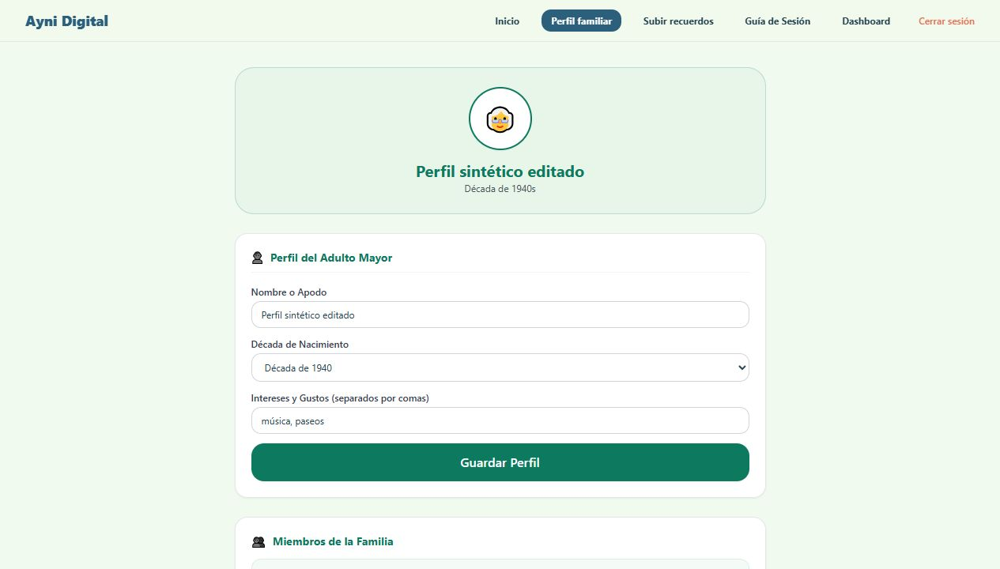
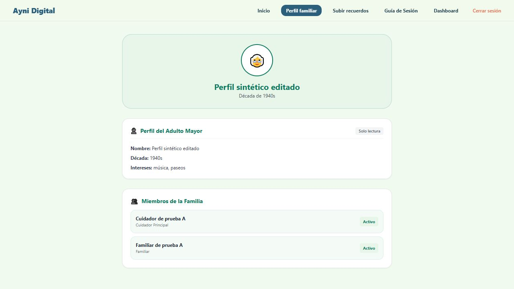
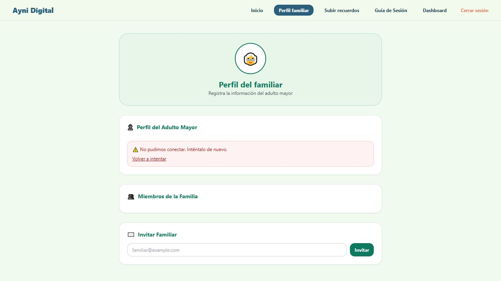

# AYNI-23 — Integración del perfil familiar

**Fecha de comprobación:** 3 de noviembre de 2026.

**Responsable del desarrollo:** Marcelo Martinez (Hats).

**Rama:** `hats/ayni-23-perfil-familiar`, basada en `c56ea72`.

## Problema y cambio

La pantalla `ProfilePage` y su cliente de API existían, pero la aplicación no importaba la pantalla ni ofrecía una vista para abrirla. El perfil no era accesible desde la navegación principal.

Se incorpora el acceso **Perfil familiar** para usuarios con sesión. El cuidador principal puede crear o editar el perfil; el familiar lo consulta en modo **Solo lectura**. El formulario valida nombre e intereses antes de enviar y deja de recortar silenciosamente la lista a 20 elementos. Los fallos de carga se muestran con una opción de reintento y el éxito solo se anuncia después de recibir una respuesta satisfactoria.

## Entorno y alcance

- Frontend local: `http://127.0.0.1:5175`.
- API local: `http://127.0.0.1:8001`.
- PostgreSQL local de pruebas: `ayni_families_test`, puerto `55432`.
- Dos familias sintéticas y un familiar invitado; ninguna cuenta o perfil real.
- `VITE_API_URL`, `DATABASE_URL`, `CORS_ORIGINS` y una clave JWT temporal se proporcionaron al iniciar los procesos, sin modificar archivos de entorno.

No se modificaron endpoints, modelos, migraciones o dependencias. Esta comprobación de desarrollo acompaña la entrega de AYNI-23; la revisión independiente de QA corresponde a AYNI-63.

## Recorrido observado en el navegador

| Caso | Resultado observado |
|---|---|
| Acceso con sesión | El botón Perfil familiar abre la pantalla del perfil |
| Perfil todavía inexistente | Se invita al cuidador principal a completar el perfil |
| Creación | Se guardaron nombre, década de 1940 e intereses; se mostró el mensaje de éxito |
| Edición | Se modificaron nombre e intereses y se mostraron los datos devueltos por la API |
| Persistencia | Tras recargar la aplicación y volver a Perfil familiar, se recuperaron los valores editados |
| Nombre compuesto solo por espacios | Se mostró el error de validación y no se anunció éxito |
| Lista con 21 intereses | Se pidió reducirla a 20; no se descartaron elementos silenciosamente |
| Un interés de 101 caracteres | Se mostró el límite de 100 caracteres por interés |
| Familiar de la misma familia | Pudo consultar los valores guardados en Solo lectura; no se mostró el formulario de edición |
| Cuidador de otra familia | Su pantalla mostró su propio perfil incompleto, sin recuperar los datos de la primera familia |
| API local temporalmente detenida | Se mostró el error de conexión y Volver a intentar; no apareció un formulario vacío como si la lectura hubiera sido satisfactoria |
| JWT invalidado al reiniciar la API de pruebas con otra clave temporal | Al reintentar, la respuesta 401 devolvió la aplicación al login; después de iniciar sesión se recuperó el perfil persistido |

### Capturas con datos sintéticos

Perfil recuperado después de editar y recargar:

Consulta con rol familiar:

Error de conexión de la API local:

## Verificaciones automáticas existentes

| Comprobación | Resultado del 03/11/2026 |
|---|---|
| `ruff format --no-cache --check .` desde backend | 79 archivos ya formateados |
| `ruff check --no-cache .` desde backend | Correcto |
| Suite completa de pytest con PostgreSQL local y carpeta temporal nueva | **446 aprobadas, 0 omitidas y 0 fallidas**; una advertencia existente de Starlette/TestClient |
| `npm test -- --pool=threads --maxWorkers=1 --no-file-parallelism` | **44 aprobadas**, en siete archivos |
| `npm run lint` | Correcto; tres advertencias existentes en UploadModule y los componentes button/badge |
| `npm run build` | TypeScript y compilación de producción correctos |

Se ejecutaron las suites existentes. No se añadieron archivos de pruebas automatizadas en este cambio.

En la revalidación previa al commit, las 446 pruebas de backend volvieron a pasar. La ejecución de frontend completó 31 pruebas en seis archivos y registró un timeout al iniciar el worker de `src/api/UploadModule.test.tsx`. Se repitió únicamente ese archivo con el mismo modo de un worker y sus 13 pruebas pasaron. No se modificó la configuración de Vitest para resolverlo.

## Reproducción y revisión

1. Iniciar sesión con un cuidador de una familia de pruebas y abrir Perfil familiar.
2. Crear el perfil, editarlo, recargar y volver a consultarlo.
3. Intentar guardar nombre en blanco, 21 intereses y un interés de más de 100 caracteres.
4. Consultar con un familiar de la misma familia y con un cuidador de una familia diferente.
5. Contrastar el recorrido con `GET` y `PUT /families/me/elder-profile`, registrados en el backend y utilizados por `frontend/src/api/families.ts`.

Las comprobaciones anteriores se realizaron en escritorio y entorno local. La aceptación en stage y la revisión en celular se registrarán con su ambiente, fecha y resultado en QA; no se dan por realizadas en este documento.
